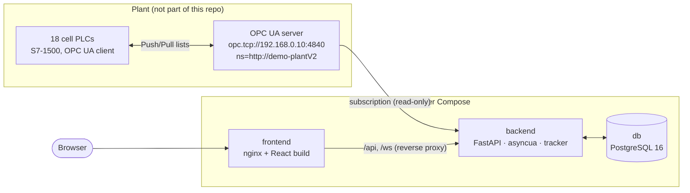
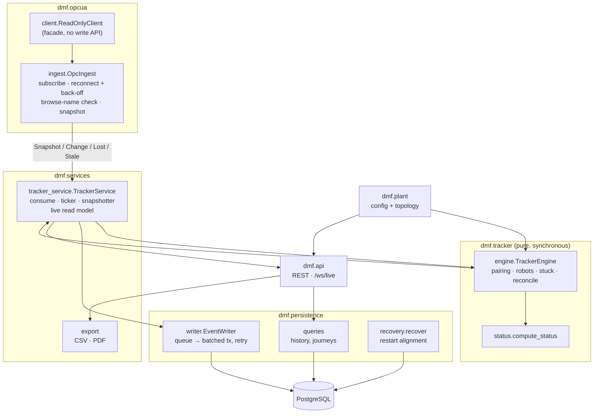
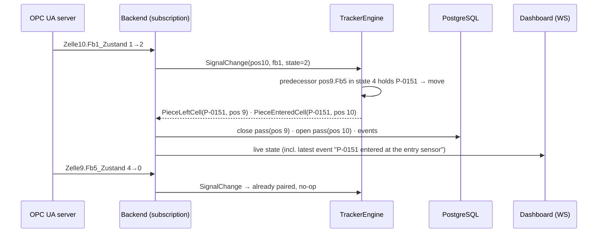
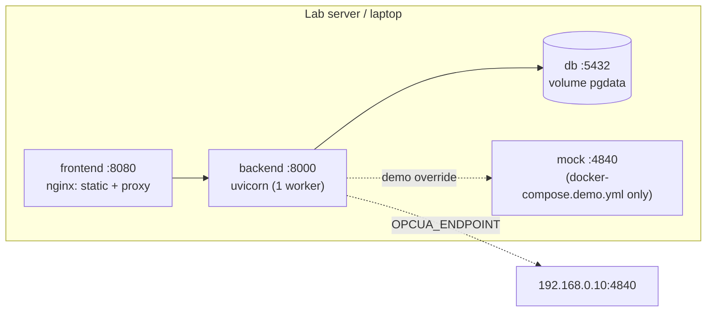

# 2 · System architecture

## 2.1 Approaches compared

| Concern | Option A — single async backend (chosen) | Option B — separate collector + API services | Option C — DB-centric (poll DB from API) |
|---|---|---|---|
| Components | `db`, `backend`, `frontend` (exactly the spec's Compose services) | + message broker (Redis/MQTT), 2 Python services | collector + API, Postgres `LISTEN/NOTIFY` |
| Latency map update | in-process, < 50 ms | broker hop | DB round-trip + notify |
| Failure modes | one process; tracker keeps running when DB is down (buffered) | more moving parts, partial failures | dashboard stalls whenever DB stalls |
| Testability | pure tracker core, replay tests | same core, more integration surface | same |
| Scale need | 326 OPC values, < 50 pieces, a few viewers | built for 100× this | — |

**Decision: Option A.** The plant is small (≈ 330 subscribed values, ≈ 20–40 pieces). The spec asks
for `db`, `backend`, `frontend`. One asyncio process holding the OPC UA client, tracker, REST and
WebSocket is the simplest design that meets the latency and reliability needs. Module boundaries
are strict, so the OPC ingest could later move out into its own process without touching the tracker core.

Other decisions:

* **Tracker = pure, synchronous domain core** (no I/O, injected clock). Signal changes go in and
  domain events come out. This makes it fully unit-testable and lets recorded lab data be replayed.
* **Live read model in memory, history in PostgreSQL.** The pages for "now" read the tracker state
  directly and History reads the database. Snapshots of the tracker state are persisted for restart
  recovery.
* **WebSocket pushes the full live state** (≈ 10 kB, coalesced to ≤ `WS_MAX_RATE_HZ`, default 4/s,
  plus a 5 s heartbeat). The latest events per cell are part of that state. Clients simply replace
  state, so there are no delta-merge bugs and a reconnecting client is consistent immediately.
* **Configuration-driven plant model** (`config/plant.yaml` + generated `config/opcua_nodes.yaml`):
  position↔cell mapping, routing ports, connections, robots/storage, thresholds and map layout. The
  frontend gets everything from `/api/plant`, so moving a cell needs no rebuild.
* **Strictly read-only OPC UA**: the backend only ever sees a facade with `connect / read / browse /
  subscribe`, and a test scans the source for any write/call API. Server-side read-only credentials are recommended.

## 2.2 Context

## 2.3 Backend components

`dmf_mock` (mock OPC UA server, demo simulator, replay, test control API) and `dmf.testing`
(PLC-faithful step sequences) are **test/demo tooling only** and are never used against the factory.

## 2.4 Data flow of one hand-over

## 2.5 Tracking engine

Inputs (`TrackerEngine` methods): `on_signal(key, value, good, now)` (one OPC value), `on_tick(now)`
(every `TICK_INTERVAL_S`), `on_connection_lost(now)`, `on_resync(values, now, reason)` (full snapshot
after connect/reconnect), `set_stale(...)`. Outputs are the domain events in `dmf/tracker/events.py`.

All inputs, including the ticks, reach the engine through **one ordered queue**; every message
carries the time it was *received*, so a tick can never overtake a notification received before it.
If the ticks stop for longer than `max(3 s, 3 × TICK_INTERVAL_S)` (stalled event loop) or the
clock jumps backwards, the open hand-over windows are shifted by that gap instead of expiring.

* **Occupancy**: conveyor holds a piece in states {2,3,4,5}; empty in {0,1,6}. Bad quality → state
  unknown; pieces are kept (the last good state is remembered) and reconciled when data is good again.
* **Directed conveyor graph** from configuration: intra-cell chains (by input/output ports and
  cell type) plus inter-cell edges (connections). Robot links and storage are external endpoints.
* **Arrival** (empty→occupied at X): candidate sources = predecessors of X that are handing over
  (state 4) or have just left (pending departure). Ranking: departure from 4 > in state 4 > departure
  from 3 (state 4 not seen — fallback, marked *uncertain*); ties by port priority. A predecessor that
  is still *waiting* in state 3/5 is no candidate: the arrival waits `HANDOVER_WINDOW_S` (a piece put
  on by hand next to a waiting piece must not take over its number). Robot-fed conveyors take the
  head of the robot FIFO first. Without any match the arrival becomes a **new piece** (`put on`/`from storage`).
* **Departure** (occupied→empty at Y): from 4 → hand-over pending; from 3 → possible removal
  pending. If no arrival pairs within the window: robot link → FIFO, storage sink → "stored",
  otherwise **taken off**. The window is **on hold** while the successor takes the piece in
  (state 1, at most `STUCK_AFTER_S`) and while a cell involved is halted (lamp 1, plant not enabled,
  stale or Bad data).
* **Cell events**: crossing a cell boundary closes the pass (`left`) and opens the next (`entered`).
  Exit conveyor in state 3, or turntable in state 5, longer than `STUCK_AFTER_S` → **stuck**.
* **Idempotency**: repeated identical values are ignored. The writer stores the sequence number of
  the last committed batch in `writer_progress` in the same transaction, so a batch whose COMMIT
  succeeded but whose reply was lost is recognised and not applied twice.
* **Reconcile** after restart/reconnect: keep pieces whose conveyor is still occupied (a conveyor
  whose piece was already handed on keeps that mark), keep hand-overs whose successor is still
  taking the piece in, move vanished pieces to unexplained downstream arrivals (upstream pieces first,
  BFS ≤ 6 conveyors, marked *uncertain*), mark the rest *lost*, and number the remaining arrivals as
  new pieces. Waiting/stuck times are part of the snapshot and survive a restart.
* **Invalid values** (a state or lamp that is not an integer, e.g. `3.7`, `"3"`, `True`) are not
  converted: they are reported as an anomaly and treated like Bad quality.

## 2.6 Cell status rules

| Priority | Condition | Status |
|---|---|---|
| 1 | OPC UA server unreachable, lamp quality Bad, or data stale (optional check) | Offline |
| 2 | `AmpelZustand = 1` | Error |
| 3 | a piece in the cell is stuck | Piece stuck |
| 4 | `AmpelZustand ∈ {2,3,4}` | Running (detail: waiting / idle / transporting; reason `partial_data` when a conveyor of the cell has no valid state) |
| 5 | any other value | Offline ("unknown lamp value") |

The global `Alarm` and `Freischalten = false` are shown as plant-wide banners.

## 2.7 Reliability

| Failure | Behaviour |
|---|---|
| OPC UA server down / network cut | exponential back-off reconnect (1 → 30 s), all cells *Offline*, banner "Connection to the factory lost"; on reconnect: full resync + reconcile |
| Node missing / wrong browse name | checked after every connect; mismatches logged and listed in `/api/status` (`node_mismatches`); the values of a mismatching node are **ignored** (treated as Bad quality, the cell shows *no valid data*) rather than trusted; a missing node delivers Bad quality |
| Bad quality value | conveyor state unknown (lamp Bad → cell *Offline, no valid data*); pieces kept and reconciled when the value is good again |
| Duplicate / out-of-order notifications | ignored when unchanged; pairing window covers either order |
| Database down | events buffered in memory (`DB_BUFFER_MAX`, default 200 000; when full the oldest events not being written are dropped and counted) and retried with back-off; only genuine data errors (SQLSTATE class 22/23) skip a single row, everything else (connection loss, "starting up", disk full, read-only, timeouts) is retried; live dashboard unaffected; history/export answer 503; banner "events are waiting" |
| Backend restart | numbering continues from DB; tracker snapshot restored (also written whenever a piece appears or ends), pieces created after the last snapshot are taken over from their open cell pass (*uncertain*), then everything is reconciled with live values; an unreadable snapshot is discarded instead of blocking start-up |
| Backend stop | ordered: stop OPC UA → handle queued messages → final snapshot → flush the writer (≤ 10 s) → stop; uvicorn graceful timeout 20 s, Compose grace period 30 s |
| Bug in a background task | an exception while handling one message is logged and forces a resync; a task that dies sets phase `failed` → `/api/health` and `/api/ready` answer 503 (container *unhealthy*) |
| Slow export | CSV/PDF rendering runs in a worker thread, so tracking and the live view are not blocked |
| Stuck piece | detected per tick; shown on map, Needs attention, Pieces now, History |
| WebSocket drop | client reconnects with back-off and receives a fresh snapshot |

## 2.8 Deployment

The backend runs a **single worker**, because the tracker is a stateful singleton. Health checks:
`/api/health` (liveness; 503 when a background task has died) and `/api/ready` (503 until migrations and restart recovery are done, whenever the database is unreachable, and after a task failure; the body also reports the OPC UA state). See [07-operations.md](07-operations.md).
